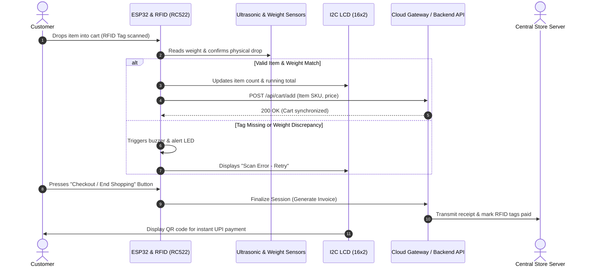
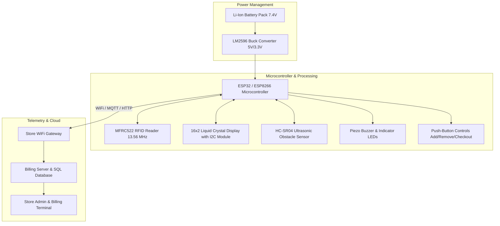

# 🛒 IoT Smart Shopping Trolley

<div align="center">

[](https://www.espressif.com/)
[](https://en.wikipedia.org/wiki/Radio-frequency_identification)
[](https://en.wikipedia.org/wiki/I%C2%B2C)
[](https://opensource.org/licenses/MIT)

**Automating Billing for a Cashier-Less, Queue-Free Retail Experience**

</div>

---

## 📖 Overview

The **IoT-Based Smart Shopping Trolley** eliminates traditional checkout lines by turning standard retail carts into autonomous self-checkout terminals. Customers scan items directly at the cart using high-frequency RFID modules. The system validates transactions through sensory weight cross-checks, updates an onboard I2C LCD in real time, and transmits the finalized bill to a central web portal for instantaneous online payment.

---

## 🔄 End-to-End System Workflow



---

## ⚙️ Hardware Architecture



---

## 🔌 Hardware Pinout Configuration

| Component | ESP32 Pin | Function |
| :--- | :--- | :--- |
| **MFRC522 (SDA / SS)** | GPIO 5 | SPI Slave Select |
| **MFRC522 (SCK)** | GPIO 18 | SPI Clock |
| **MFRC522 (MOSI)** | GPIO 23 | SPI Master Out |
| **MFRC522 (MISO)** | GPIO 19 | SPI Master In |
| **MFRC522 (RST)** | GPIO 22 | Reset Line |
| **I2C LCD (SDA)** | GPIO 21 | I2C Data Line |
| **I2C LCD (SCL)** | GPIO 22 | I2C Clock Line |
| **HC-SR04 (Trig)** | GPIO 4 | Ultrasonic Trigger |
| **HC-SR04 (Echo)** | GPIO 2 | Ultrasonic Echo |
| **Buzzer** | GPIO 15 | Audio Feedback |

---

## 💻 Firmware Setup & Flashing

### Requirements
- Arduino IDE or PlatformIO
- ESP32 Board Support Package
- Libraries: `MFRC522`, `LiquidCrystal_I2C`, `WiFiClientSecure`, `PubSubClient`

### Flashing
1. Open `firmware/smart_trolley.ino` in Arduino IDE.
2. Configure your WiFi credentials and Server Endpoint in `config.h`:
   ```cpp
   #define WIFI_SSID "STORE_WIFI"
   #define WIFI_PASS "secure_password"
   #define API_SERVER "http://192.168.1.100:5000/api/cart"
   ```
3. Connect ESP32 via Micro-USB and select the appropriate COM port.
4. Click **Upload**.

---

## 📄 License
Distributed under the MIT License. See `LICENSE` for details.
